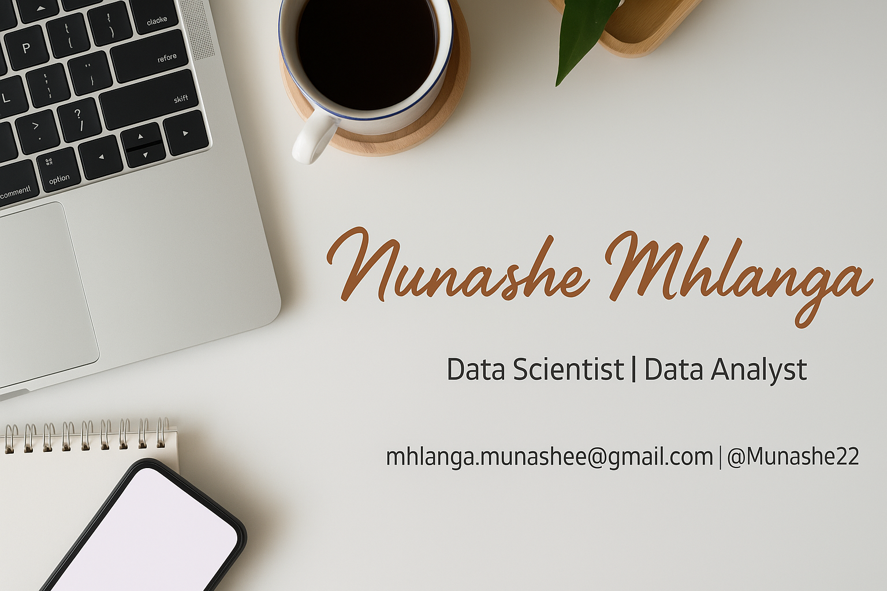

## 🙋‍♂️ Introducing Myself
***

Hello, I'm Munashe. I am a Data Scientist with expertise in Machine Learning and Data Analytics. 

- Querying data using SQL and scraping using APIs
- Exploratory Data Analysis using Python or R
- Machine Learning / Deep Learning / Computer Vision using Python (PyTorch)
- Developing dashboards on Tableau and Power BI

# Projects

### Do Gen Z Have It Tough? The U.S. Economy Over the Years

An evidence-driven mini-analysis examining whether Gen Z (born ~1997–2012) faces worse economic prospects than prior generations. Using historical data, the project compares three core needs—healthcare, housing, and food security—across generations (1960–present) to assess whether Gen Z is worse off; findings point to worsening housing affordability, unequal healthcare burdens, and persistent food insecurity for vulnerable groups.
<a href="https://munashe.georgetown.domains/US-Economy-Mini-Viz/" style="color:blue;">See The Website</a>
[Project Repo](https://github.com/Munashe22/US-Economy-Boomers-Millenials-GenZ)

### Barbados Traffic Prediction using Neural Networks
Predicting traffic using computer vision to identify the root causes of traffic in a Barbados roundabout. Full data science pipeline leveraging Pytorch, YOLO model, Random Forest models, and other machine learning techniques.
[Project Repo](https://github.com/Munashe22/Barbados-Traffic-Prediction-Using-Deep-Learning/tree/main)

### Understanding Cancer Outcomes: Breast vs. Cervical Cancer
The project investigates survival patterns in breast and cervical cancer using data from The Cancer Genome Atlas (TCGA). Patients with the same diagnosis often experience different outcomes based on factors such as age, cancer stage, treatment received, and other clinical variables. Understanding these patterns can support improvements in patient care and the personalization of treatment strategies. Full Data Science pipeline leveraging Python (including parametric machine learning, classic regression, and boosting methods for prediction)
<a href="https://munashe.georgetown.domains/DSAN-5000-Project/" style="color:blue;">See The Website</a>
[Project Repo](https://github.com/Munashe22/Understanding-Cancer-Outcomes-Breast-vs-Cervical)

### Global Analysis of Sentiment and Bias in News Headlines
The world changed dramatically during and after the COVID-19 pandemic: dramatic shifts to online platforms, growing distrust of traditional news media, rising reliance on social media, and self-reinforcing negative feedback loops from recommendation algorithms. These changes raise an important research question: how is the news landscape evolving in the U.S. compared with the rest of the world? News headlines are among the most influential aspects of journalism. They shape a reader’s first impressions, guide opinions, and circulate through news recommendation algorithms. Unfortunately, this increasing reliance on headlines has also been exploited to inject or reinforce media biases.
<a href="https://github.com/Munashe22/Sentiment-and-Bias-in-Headlines/blob/main/eda/sentiment.png" style="color:purple;">See a viz</a>
[Project Repo](https://github.com/Munashe22/Sentiment-and-Bias-in-Headlines)

### Upcoming
- A Python function to be added to the language: *EDA function that takes a dataframe and returns characteristics beyond df.describe()*

# Tools

- Languages: Python, R, SQL
- Visualization: Tableau, Power BI, Metabase
- Cloud: AWS, Google Cloud, Microsoft Azure

# Connect with me

- [LinkedIn](https://www.linkedin.com/in/munashe-mhlanga/)

# Additional Info

- Languages: English, Shona, Ndebele, Zulu, French
- Interests: Soccer, Basketball, Formula 1, Muay Thai, Hiking
